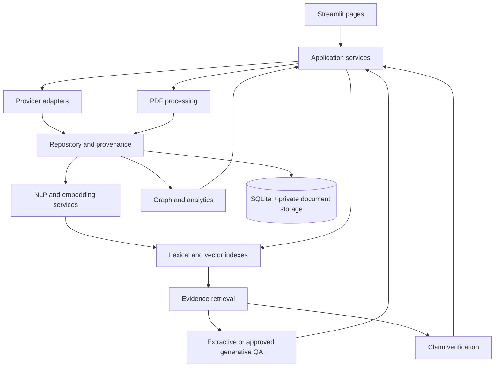

# Architecture and internal API specification
## Decision records
ADR-01: modular monolith with Streamlit, Python 3.11, Pydantic, SQLAlchemy 2 and SQLite. Avoid REST overhead for a single-user local app. FastAPI/Postgres become options only when separate clients/concurrency demand it.
ADR-02: CPU-first NumPy cosine index with persisted model/version metadata; FAISS optional after benchmark and Windows wheel check. PyTorch, transformers and sentence-transformers installed only when needed. Use PyMuPDF for PDF extraction subject to license review; GROBID and Tesseract optional adapters after approval. NLTK/spaCy for linguistic inspection, scikit-learn for baselines, NetworkX/PyVis for graphs, Plotly for charts. Gensim only if word-vector experiment warrants it. Joblib artifacts loaded only from trusted local runs.
ADR-03: default extractive Q&A, optional local generation (e.g. approved Ollama model); external LLM disabled. Never silently substitute extractive output for generative RAG; show active mode.
ADR-04: data acquisition OpenAlex primary, Crossref enrichment, arXiv optional domain discovery, Semantic Scholar optional recommendations, Europe PMC optional biomedical adapter. Each provider has budget, cache and licensing controls.



## Proposed project tree (not created yet)
```
researchmind/
  app.py
  .streamlit/config.toml
  src/researchmind/
    config.py, schemas.py, errors.py
    ui/ (pages, components, styles)
    services/ (library, discovery, analysis, comparison, assistant)
    providers/ (openalex, crossref, arxiv, semantic_scholar, europe_pmc)
    documents/ (validation, parsing, sections, chunking)
    nlp/ (preprocess, entities, classification, topics, stance)
    retrieval/ (lexical, embeddings, hybrid, evaluation)
    reasoning/ (generation, citations, verification, gaps)
    graph/ (builder, queries)
    analytics/
    db/ (models, repositories, migrations)
  tests/ (unit, integration, fixtures, ui, benchmarks)
  docs/  scripts/  data/ (ignored)  models/ (ignored)
  pyproject.toml  .env.example  .gitignore
  Dockerfile  .github/workflows/ci.yml
```
## Internal service contracts
| Operation | Input | Output |
|---|---|---|
| discover | query, filters, provider, cursor | SearchPage(records, next_cursor, warnings) |
| ingest | validated bytes, optional paper ID | DocumentResult(id, pages, extraction status) |
| analyze | paper ID, summary mode | FieldResults(value, status, evidence IDs) |
| retrieve | query, collection, mode, k | RankedHits(id, score, rank, model version) |
| compare | paper IDs, fields | Table of FieldResults |
| answer | question, scope, generation mode | Answer(text, citations, status, run ID) |
| verify | claim, scope | EvidenceAssessment(label, evidence, caveats) |
| graph | collection, relationship types | Nodes/Edges with provenance |
| analytics | collection, filters | Counts, denominators, candidate leads |
| evaluate | dataset version, split, model config | EvaluationRun(metrics, artifacts, failures) |

Pydantic validates input/output; service exceptions map to actionable UI errors. Transactional repository writes and index rebuild/version checks avoid stale retrieval. No separate HTTP API is justified yet; if approved later, map these contracts to versioned endpoints with auth, paging and OpenAPI.
