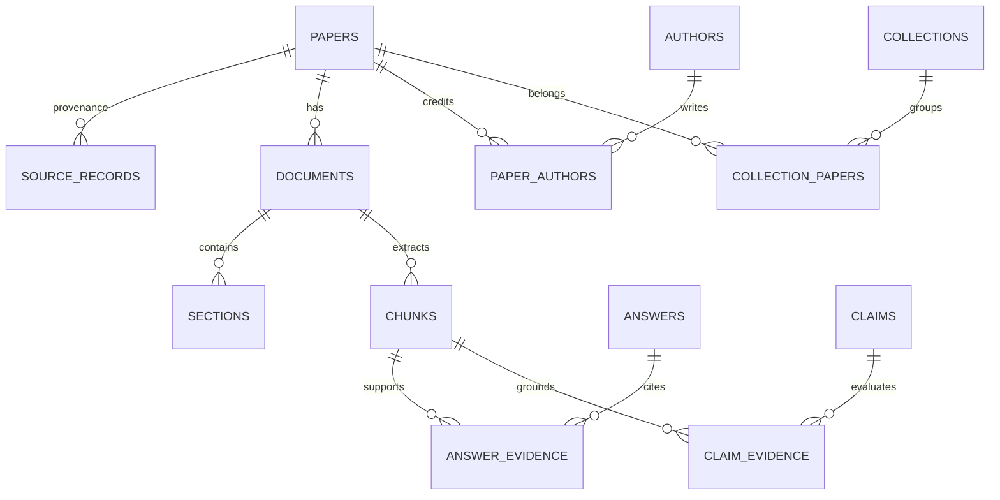

# Database schema and literature sourcing
Use SQLite foreign_keys=ON, WAL where supported, UTC timestamps, UUID or integer surrogate keys, migration revisions, unique constraints, parameterized queries. Store PDFs privately by content hash; do not store keys in DB. All extracted evidence retains provenance.

| Table | Principal columns / constraints |
|---|---|
| papers | id PK, doi UNIQUE nullable, title, abstract, year, venue, type, url, oa_status, access_level, created_at |
| source_records | id PK, paper_id FK, provider, external_id, raw_json, retrieved_at, license, UNIQUE(provider,external_id,retrieved_at) |
| authors, institutions | id PK, external_id nullable, name |
| paper_authors | paper_id FK, author_id FK, position, composite PK |
| affiliations | paper_id, author_id, institution_id FKs, composite PK |
| documents | id PK, paper_id FK, sha256 UNIQUE, path, mime, page_count, extraction_status, license |
| sections | id PK, document_id FK, heading, kind, start_page, end_page |
| chunks | id PK, document_id FK nullable, source_record_id FK nullable, section_id FK nullable, page nullable, offsets, text, hash; exactly one document or abstract source |
| model_versions | id PK, name, revision, config_json, license |
| embeddings | chunk_id or paper_id FK (exclusive), model_id FK, dimensions, index_key, hash; unique target/model |
| collections, collection_papers | collection PK; membership composite PK, timestamps |
| citations | citing_id FK, cited_id FK, source_record_id FK, unique citing/cited/source |
| entities | id PK, type, normalized_name, display_name |
| relationships | id PK, from_entity_id, to_entity_id, type, evidence_chunk_id or source_record_id, extraction_method |
| summaries | id PK, paper_id FK, model_id FK, field, value, status |
| summary_evidence | summary_id, chunk_id FKs, composite PK |
| retrieval_runs, retrieval_hits | run PK, query, scope, config; hit rank, chunk/paper FK, score |
| questions, answers, answer_evidence | question PK, answer FK, status, model/run FK; evidence links with claim span |
| claims, claim_evidence | claim PK, label, run FK; chunk FK, stance, explanation |
| evaluation_runs | id PK, dataset/version/split, model config, metrics JSON, runtime, artifact path |
| activity | id PK, event, target, timestamp (no sensitive content in logs) |

Indexes: papers(year), papers(title), source_records(provider,external_id), chunks(document_id,page), citations(cited_id), relationships(type), retrieval_hits(run_id,rank). Entity types cover topics, methods, datasets and paper/author/institution IDs via typed mappings. Users table deferred until approved authentication. Deletion cascade for owned derived records; shared paper metadata kept if still referenced.

## Source decision matrix
| Provider | Use | Access / limitations |
|---|---|---|
| OpenAlex | broad work metadata, authors, citations, topics | metered free allowance; key for deeper cursor pagination; eligible OA content only |
| Crossref | DOI enrichment, publication metadata | follow current polite-pool requirements; full text not guaranteed |
| arXiv | CS preprints and abstracts | honor API pacing; preprints not necessarily peer reviewed; license varies |
| Semantic Scholar | recommendations and citation graph | key access/rate limits; initial key limit documented as 1 RPS; abstract/PDF access varies |
| Europe PMC | biomedical abstracts and eligible full text | OA license and full-text availability vary |
| Repositories / uploads | authorized PDF | verify rights, file type, hash and provenance; no paywall bypass |

Cache provider responses by normalized query and cursor; exponential backoff with jitter on 429/5xx, honor Retry-After, finite retries, timeout, daily budget circuit breaker. Redact keys. Preserve original raw response separate from normalized record; DOI canonicalization, provider ID and hash matching; fuzzy title matches flagged for review, not automatic merge. Store abstract vs full-text access labels; record URL, source time, publication type, references, dataset/method only if evidenced. Source docs: https://help.openalex.org/api/authentication/ ; https://help.openalex.org/access/fulltext/ ; https://www.crossref.org/documentation/retrieve-metadata/rest-api/ ; https://info.arxiv.org/help/api/index.html ; https://www.semanticscholar.org/product/api ; https://europepmc.org/RestfulWebService . Verify current quotas before implementation; no live provider calls performed.
