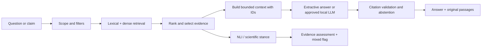

# NLP, ML, retrieval and evidence architecture
## Document processing
Validate magic bytes, MIME, size, page limit and encryption; store hash and original file. Extract layout blocks with coordinates using PyMuPDF, sort columns using geometry, retain raw page text and normalized copy with reversible offsets. Detect headings using typography and numbering; map to abstract, introduction, methods, results, discussion, conclusion, references, limitations, future work. Flag ambiguous sections, missing text, tables/figures/equations; do not infer unreadable values. Optional local OCR only for necessary pages, label OCR provenance; GROBID optional for TEI and references. Split by paragraph/section and page boundary, 300–500 tokens with 50 overlap as starting settings; benchmark chunk sizes. No synthetic page references for abstract-only sources.

## NLP and ML laboratory
Original text never overwritten. Unicode NFC, whitespace cleanup, preserve case and punctuation for scientific symbols; case folding/stopwords/stemming are optional lexical views only. NLTK sentence/word tokens and Porter stemming; spaCy lemmas/POS/general NER with model availability checks. Scientific entities use controlled dictionaries, section context, candidate patterns and an evaluated scientific model where appropriate; generic NER does not establish methods/datasets. Show raw and transformed output and model revision. BoW/TF-IDF with uni/bi/trigrams; optional pretrained word vectors or corpus-trained Word2Vec only with adequate corpus; contextual SciBERT pooling is experimental, not assumed ideal for similarity; compare general sentence encoder and SPECTER2 task-appropriate adapter for title/abstract document retrieval. Passage encoder separate; normalize vectors, store dimensions and revision. CPU batches and lazy model loading.

Train TF-IDF + logistic regression as domain-classification baseline using labeled arXiv categories, split by paper ID and deduplicate before splitting. Multi-label categories require multi-label evaluation; do not label method classification as validated without annotations. Compare transformer classifier only if feasible. LDA/NMF on suitable corpus; optional embedding clustering, show top words and membership, topics are descriptive. Scientific stance: distinguish uncertainty, limitations, negative results, disagreement and positive findings using rules as baseline, then evaluated classifier if labels exist. Ordinary review sentiment not appropriate. Record model cards/licenses, seeds, split, hyperparameters and failure cases.

## Retrieval
Exact terms and metadata filters; TF-IDF cosine and BM25; dense paper and passage indexes separately. Default hybrid reciprocal rank fusion: score(d)=sum(1/(60+rank_i(d))) across lexical/dense ranks, missing docs contribute zero. Metadata filters applied consistently; recency/citation signals only explicit optional preferences, never quality scores. Optional cross-encoder rerank top 20; explain rank contributors and similarity, not confidence. Deterministic tie-break by paper ID; compare same corpus and query split. Related papers use title/abstract embedding and verified shared entities/citations; explain why. Rebuild on changes and record index hash, model revision and corpus manifest.

## Structured paper analysis
Field results contain value, status (explicit / inferred / unavailable), evidence IDs, method and model revision. Extract research problem, objectives/questions, background, method/algorithm, dataset, setup, results, contribution, limitations and future work. Prefer section-aware extractive sentences; optional generative summaries grounded only in selected text. Technical, simplified, abstract, full, section and multi-paper modes keep evidence. Compare paper fields side by side; do not compare unlike metrics or units without caveats. Never fabricate absent fields.

## RAG and claim verification

Preserve query verbatim; normalize only retrieval view. Deduplicate overlapping chunks; context includes stable IDs and pages. Treat documents as untrusted text, not instructions. Generator emits structured answer with claim-to-evidence IDs; reject unknown IDs, verify quoted text matches stored passage, flag unsupported claims; citation presence alone is not entailment. Default extractive mode returns ranked passages and conservative explanation; report not found when threshold fails. Local generative adapter optional after approval, external LLM off by default. No fabricated citations, page numbers, confidence scores. Claim verifier uses evaluated NLI/scientific model on claim/passage pairs, aggregates support/contradiction/insufficient; if both directions found, show mixed flag and both sets without forcing verdict. Low similarity is not contradiction. Calibrate thresholds on dev set, evaluate held-out SciFact; label domain shift. Research gaps derive from repeated limitation passages, sparse method/application co-occurrence and differences in results; each lead lists evidence, corpus coverage, search scope and suggested validation query. Never assert global novelty.

## Research references
SciBERT https://arxiv.org/abs/1903.10676 ; SPECTER https://arxiv.org/abs/2004.07180 ; SPECTER2 https://github.com/allenai/SPECTER2 ; SciRepEval https://arxiv.org/abs/2211.13308 ; RAG https://arxiv.org/abs/2005.11401 ; SciFact https://github.com/allenai/scifact ; BEIR https://github.com/beir-cellar/beir ; GROBID https://github.com/kermitt2/grobid . Model and dataset terms must be reviewed before redistribution.
